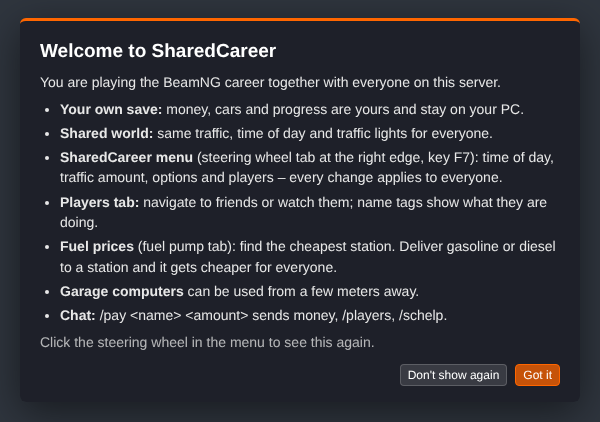
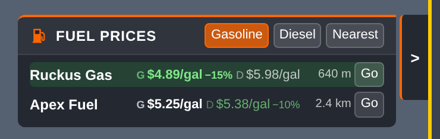

<div align="center">


# SharedCareer

**Play the BeamNG.drive career together on a BeamMP server.**

One shared world (same traffic, same time of day, same traffic lights), while every player keeps their **own save** on their own PC.

[](https://github.com/MrCurby/SharedCareer/releases/latest)
[](https://github.com/MrCurby/SharedCareer/actions/workflows/release.yml)


[Features](#features) · [Quick start](#quick-start) · [Server setup](docs/server-setup.md) · [In-game guide](docs/features.md) · [Settings & commands](docs/configuration.md) · [Development](docs/development.md)

</div>

---

## What is SharedCareer?

The BeamNG career is made for playing alone. If you try it on a multiplayer server, lots of things go wrong: loading your career deletes your friends' cars, everyone has a different time of day, your traffic shows up with your name on it, and so on.

**SharedCareer fixes all of that.** It's a small mod for BeamMP servers that lets you play the normal BeamNG career together with your friends:

- Join the server and your career **starts by itself**. No menus, nothing to set up.
- Play the career like you always do: buy cars, do deliveries and missions, use your garage.
- Everyone drives in the **same world**, and the mod keeps it the same for everyone.
- **Your progress stays yours**: your money, cars and missions are saved on your own PC, just like in single player.

**Made for small groups of friends.** SharedCareer is built for a few friends who just want to hang out on a BeamMP server and enjoy the career together, without stress and without things breaking. It's not made for big public servers.

SharedCareer doesn't add new game modes like races or leaderboards. It just makes the career you already know work well with friends. The idea came from [Mileage](https://github.com/norto22/Mileage), but SharedCareer is its own, much smaller mod.

Players **don't need to install anything**. BeamMP downloads the mod for them when they join.

## Features

| | |
|---|---|
|  **Own save per player** | Each player has their own career save, tied to their BeamMP account. Renaming your BeamMP account keeps your save. |
|  **Safe career start** | Other players' cars survive when your career loads. Duplicate cars in the garage are prevented. |
|  **One shared world** | Same time of day, same traffic light cycle and the same amount of traffic for everyone. |
|  **Day & night cycle** | Long days and short nights (default 50 min day, 5 min night). Anyone can pause the clock or jump to a time. |
|  **Lightweight, careful traffic** | Traffic uses simplified vehicles that are cheap to sync, and the AI keeps more distance. The server splits a total traffic limit across all players. |
|  **SharedCareer menu** | An in-game window (key **F7**) with tabs for time, traffic, options and players. Every change applies to everyone instantly. |
|  **Find your friends** | Navigate to a player with a route on the road, or watch them. Name tags show what players are doing: *Mission*, *On foot*, *Loading*. |
|  **Shared fuel prices** | Everyone pays the same price at a station. Deliver gasoline or diesel and that station gets cheaper for everyone. A fuel app shows the cheapest station. |
|  **Garage computers from a distance** | Use the garage computer from anywhere in the room instead of standing exactly in front of it. |
|  **Send money** | `/pay <name> <amount>` in chat, with automatic refund if something goes wrong. |
|  **Welcome dialog** | New players get a short overview when they join, with a "Don't show again" option. |
|  **Painless updates** | Settings migrate automatically on updates. One command on the server installs the newest release. |

## Screenshots

**The SharedCareer menu**: time of day, options and players. It collapses into a small steering-wheel tab at the right screen edge.


<table>
<tr>
<td width="50%" valign="top">

**Welcome dialog** on join



</td>
<td width="50%" valign="top">

**Fuel prices**: every station, cheapest first, with a route there



</td>
</tr>
</table>

## Quick start

### For players

1. Join a server that runs SharedCareer.
2. Wait for the career to load. You land in the world in your own career save.
3. Open the menu with the **steering-wheel tab** at the right screen edge, or press **F7**.

That's it. Your save lives in your normal BeamNG user folder under a profile named after your BeamMP account.

### For server owners

Requirements: a BeamMP server on Linux, BeamNG.drive 0.39 or newer. West Coast USA is the recommended map.

```bash
# 1. In your BeamMP server folder: get the control script
curl -fsSL -o server.sh https://raw.githubusercontent.com/MrCurby/SharedCareer/main/tools/server.sh && chmod +x server.sh

# 2. Tell it where releases come from
echo 'REPO="MrCurby/SharedCareer"' > server.conf

# 3. Install the newest release and start the server
./server.sh update
```

Then set `MaxCars = 100` in `ServerConfig.toml`, because traffic counts as the player's cars. Later updates are again just `./server.sh update`.

The full guide, including manual installation, backups, rollback and switching from Mileage, is in **[docs/server-setup.md](docs/server-setup.md)**.

## Documentation

| Guide | Contents |
|---|---|
| [Server setup](docs/server-setup.md) | Installation, `server.sh`, updates, rollback, save games, switching from Mileage |
| [In-game guide](docs/features.md) | The menu, welcome dialog, players tab, fuel economy, traffic, garage computers |
| [Settings & commands](docs/configuration.md) | Chat and console commands, every setting in `config.json` |
| [Development](docs/development.md) | Building, tests, releases, how the mod works inside, known limitations, project status |

## Status

SharedCareer is under active development and was tested with **BeamNG.drive 0.40.5**, **BeamMP 4.23.1** and **BeamMP-Server 3.9.3** on Linux. Joining, the career start, traffic, vehicle and damage sync, buying cars, the shared time of day and the garage computers have been tested with real players. Other career features are listed with their test status in [docs/development.md](docs/development.md#project-status).

Found a bug? Please [open an issue](https://github.com/MrCurby/SharedCareer/issues) and add the lines containing `sharedCareer` from your `beamng.log`.
