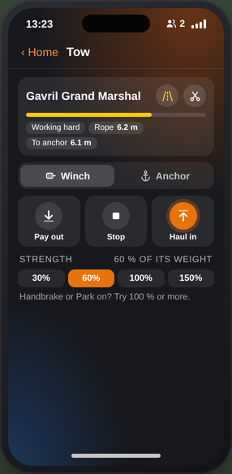
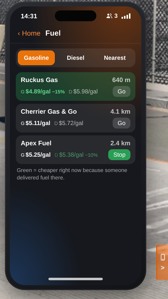

<div align="center">


# SharedCareer

**Play the BeamNG.drive career together on a BeamMP server.**

One shared world (same traffic, same time of day, same traffic lights), while every player keeps their **own save** on their own PC. Plus optional extras for playing together.

[](https://github.com/MrCurby/SharedCareer/releases/latest)
[](https://github.com/MrCurby/SharedCareer/actions/workflows/release.yml)


[Features](#features) · [Quick start](#quick-start) · [Server setup](docs/server-setup.md) · [In-game guide](docs/features.md) · [Settings & commands](docs/configuration.md) · [Development](docs/development.md)

</div>

---

## What is SharedCareer?

The BeamNG career is made for playing alone. If you try it on a multiplayer server, lots of things go wrong: loading your career deletes your friends' cars, everyone has a different time of day, your traffic shows up with your name on it, and so on.

**SharedCareer fixes all of that.** It's a small mod for BeamMP servers that lets you play the normal BeamNG career together with your friends:

- Join the server and your career **starts by itself**. No menus, nothing to set up.
- Play the career like you always do: buy cars, do deliveries and missions, use your garage.
- Everyone drives in the **same world**, and the mod keeps it the same for everyone.
- **Your progress stays yours**: your money, cars and missions are saved on your own PC, just like in single player.

**Made for small groups of friends.** SharedCareer is built for a few friends who just want to hang out on a BeamMP server and enjoy the career together, without stress and without things breaking. It's not made for big public servers.

**How it's built.** At its heart, SharedCareer is the normal BeamNG career, made to work with more than one player. Those fixes always run. On top of that come **extras for playing together**, like shared fuel prices, finding your friends or a rope and winch to move vehicles that can't drive. Each extra is listed separately below and can be switched off by the server.

Players **don't need to install anything**. BeamMP downloads the mod for them when they join.

## Features

### Fixes: making the career work with friends

Without these, the career breaks or behaves strangely on a multiplayer server.

| | What it does | Can be turned off? |
|---|---|---|
|  **Career starts on join, own save** | Your career loads by itself when you join. Each player has their own save, tied to their BeamMP account, so renaming your account keeps your save. | No (core of the mod) |
|  **Safe career start** | Loading your career no longer deletes your friends' cars, and the garage no longer creates duplicate cars. | No |
|  **Same world for everyone** | Same time of day and same traffic light cycle for everyone. Cars that the career hides or shows (garage, dealer) are hidden or shown for everyone too. | Time and traffic lights: yes |
|  **Traffic that doesn't overload the server** | The server splits a total traffic limit across all players, and traffic uses simplified cars that are cheap to sync. Your traffic no longer carries your name tag. | Limit and simple cars: yes |
|  **Same fuel price for everyone** | Normally every player rolls their own random price at the same station. With SharedCareer everyone pays the same. | Yes (together with the fuel extra below) |

### Extras: more things to do together

These go beyond the normal career. They are on by default unless noted, and each one can be switched off.

| | What it does | Can be turned off? |
|---|---|---|
|  **Long days, short nights** | Default: 50 min day, 5 min night, instead of the game's own day length. Anyone can pause the clock or jump to a time. | Yes, lengths are adjustable, or each player keeps their own time |
|  **More careful traffic AI** | The AI notices slow or standing vehicles earlier (for example your truck while you maneuver), keeps more distance and brakes earlier at intersections and traffic lights. It doesn't drive slower. The police are not affected. | Yes (back to the game's AI) |
|  **SharedCareer menu** | An in-game window (key **F7**) for time, traffic, options and players. Every change applies to everyone. | Changing things can be limited to the server console |
|  **Find your friends** | Navigate to a player or watch them, and see what others are doing on their name tags (*Mission*, *On foot*, *Loading*). Teleporting to a player is **off** by default. | Name tag status and teleport: yes |
|  **Cheaper fuel through deliveries** | Deliver gasoline or diesel to a station and it gets cheaper there for everyone for a while. The **Fuel** app on the phone shows the cheapest station. | Yes |
|  **Garage computers from a distance** | Use the garage computer from anywhere in the room instead of standing right in front of it. | On other maps: yes. On West Coast USA it comes from a map file in the mod, so it's always on |
|  **Node grabber everywhere** | The normal career only lets you grab and pull vehicles with the mouse while walking. SharedCareer also allows it in a vehicle and in the free camera. The pull stays as weak as in the normal career (the game engine limits it), so it's good for nudging and turning cars, not for throwing them. The vehicle certification test still blocks it. | Yes (back to the career's rule) |
|  **Rope and winch** | Move vehicles that can't drive, for example onto a tow truck, slowly and with physics. Everything runs in the **Tow** app on the phone, as a remote control: attach the rope, move the anchor, run the winch in or out. A colored rope shows how hard it pulls; the pull strength (30–150 % of the vehicle's weight) is picked in the app. A vehicle the rope can't free (wrapped around a lamp post) can be towed to the road, free of charge, damage included. Only your own vehicles. | Yes |
|  **Phone** | A phone in the game (key **F4**, or the tab at the right screen edge) with the server time and the number of players, and three apps: **Jobs** (towing jobs, beta), **Tow** (rope and winch as a remote control) and **Fuel** (gas station prices). | Yes |
|  **Towing jobs** *(beta)* | Broken-down cars at the roadside, one list for everyone in the **Jobs** app: take a job, drive there, tow the car to a repair shop and get paid. New damage on the way costs part of the pay. | Yes |
|  **Send money** | `/pay <name> <amount>` in chat, with an automatic refund if something goes wrong. | Yes |
|  **Welcome dialog** | A short overview when you join. Each player can pick "Don't show again". | Yes |

How to switch things off: [Settings & commands](docs/configuration.md).

### Good to know: what the mod changes on your PC

The mod only runs while you are on a SharedCareer server (BeamMP only loads it there). While it runs:

- **Console and world editor are locked**, and time, weather and traffic in the pause menu are display-only. This keeps the shared world the same for everyone. The server can allow both.
- **Two game settings are set by the server** (simplified traffic cars, optionally simplified cars of other players). Your own values come back when you leave.
- **Your UI layout gets the SharedCareer menu and the phone tab**, once. If you remove them, they don't come back.
- **On West Coast USA, the garage computer zones are bigger** (the mod ships a changed copy of that map file).

These changes stay after you leave:

- **Your save** is a normal career save in your BeamNG user folder, named after your BeamMP account.
- **Your UI layout** keeps the two SharedCareer apps (you can remove them).
- **A small file** `settings/sharedCareer/state.json` remembers choices like "Don't show again".

For server owners: settings move to new defaults automatically on updates, and `./server.sh update` installs the newest release. See [Server setup](docs/server-setup.md).

## Screenshots

**The SharedCareer menu**: time of day, options and players. It collapses into a small steering-wheel tab at the right screen edge.


<table>
<tr>
<td width="50%" valign="top">

**Welcome dialog** on join


</td>
<td width="25%" valign="top">

**Tow** app: rope and winch



</td>
<td width="25%" valign="top">

**Fuel** app: cheapest station



</td>
</tr>
</table>

## Quick start

### For players

1. Join a server that runs SharedCareer.
2. Wait for the career to load. You land in the world in your own career save.
3. Open the menu with the **steering-wheel tab** at the right screen edge, or press **F7**.

That's it. Your save lives in your normal BeamNG user folder under a profile named after your BeamMP account.

### For server owners

Requirements: a BeamMP server on Linux, BeamNG.drive 0.39 or newer. West Coast USA is the recommended map.

```bash
# 1. In your BeamMP server folder: get the control script
curl -fsSL -o server.sh https://raw.githubusercontent.com/MrCurby/SharedCareer/main/tools/server.sh && chmod +x server.sh

# 2. Tell it where releases come from
echo 'REPO="MrCurby/SharedCareer"' > server.conf

# 3. Install the newest release and start the server
./server.sh update
```

Then set `MaxCars = 100` in `ServerConfig.toml`, because traffic counts as the player's cars. Later updates are again just `./server.sh update`.

The full guide, including manual installation, backups and rollback, is in **[docs/server-setup.md](docs/server-setup.md)**.

## Documentation

| Guide | Contents |
|---|---|
| [Server setup](docs/server-setup.md) | Installation, `server.sh`, updates, rollback, save games |
| [In-game guide](docs/features.md) | The menu, welcome dialog, players tab, fuel economy, traffic, garage computers |
| [Settings & commands](docs/configuration.md) | Chat and console commands, every setting in `config.json` |
| [Development](docs/development.md) | Building, tests, releases, how the mod works inside, known limitations, project status |

## Status

SharedCareer is under active development and was tested with **BeamNG.drive 0.40.5**, **BeamMP 4.23.1** and **BeamMP-Server 3.9.3** on Linux. Joining, the career start, traffic, vehicle and damage sync, buying cars, the shared time of day and the garage computers have been tested with real players.

Found a bug? Please [open an issue](https://github.com/MrCurby/SharedCareer/issues) and add the lines containing `sharedCareer` from your `beamng.log`.
