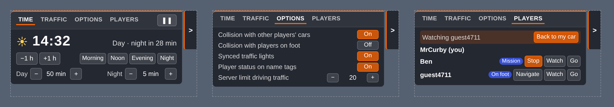
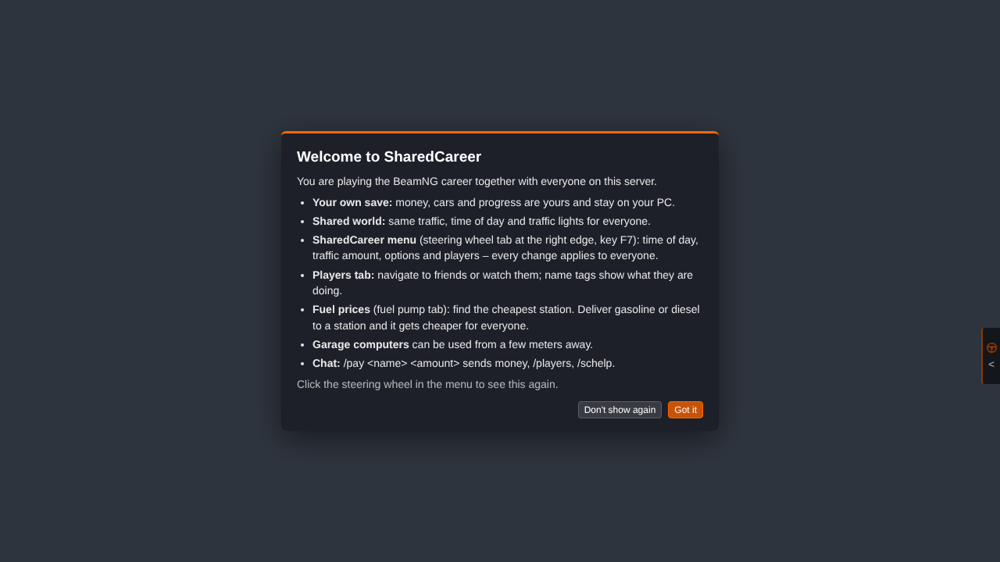
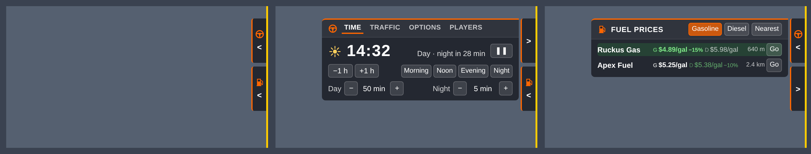

# SharedCareer

Gemeinsamer Karrieremodus für **BeamNG.drive** auf **BeamMP**. Alle spielen die normale Karriere in einer geteilten Welt: dieselben Straßen, derselbe Traffic, dieselben Ampeln. Jeder hat dabei seinen **eigenen Spielstand** auf dem eigenen PC.

Das Projekt ist vom Aufbau her an [Mileage](https://github.com/norto22/Mileage) angelehnt, ist aber eine eigene, bewusst schlanke Umsetzung (ca. 1.800 statt 21.000 Zeilen). Rennen, Drag-Strip und Bestenlisten sind nicht enthalten. Der Fokus liegt darauf, dass die Karriere selbst stabil läuft.

## Was es macht

| Problem in der Karriere im Multiplayer | Lösung | Datei |
|---|---|---|
| Beim Karrierestart löscht das Spiel **alle fremden Autos** | Schutz während `activateCareer`: `removeAll` und die „sichere Liste“ verschonen fremde Fahrzeuge | `protect.lua` |
| Ein fehlerhaftes Karriere-Modul blockiert alle weiteren (z.B. Versicherung kaputt) | jeder `onCareerActive`-Handler läuft beim Start in `xpcall` | `protect.lua` |
| Karrierestart muss beim Join automatisch passieren | Server schickt Einstellungen, Client startet Profil `<BeamMP-Name><Suffix>` im Modus *Open World* | `core.lua` |
| Join hängt ewig im Ladebildschirm | nach 60 s werden hängende Ladebildschirme freigegeben, Ergebnis geht an den Server | `core.lua` |
| Karriere versteckt/zeigt Autos (Garage, Händler), andere sehen das nicht | Sichtbarkeit wird über den Server synchronisiert | `vehicles.lua` |
| Dein Name steht über jedem deiner Traffic-Autos | Traffic/geparkte Autos werden markiert, Namensschild ausgeblendet | `vehicles.lua` |
| Eigene Polizei/Traffic „übernimmt“ fremde Spieler | fremde Autos bekommen `ignoreTraffic` | `vehicles.lua` |
| **Doppelte Autos** beim Tunen/Teile/Lackieren am Garagen-Computer | BeamMP baut das falsche Auto neu → für den Aufruf zeigt `getPlayerVehicle(0)` auf das richtige | `garage.lua` |
| Fußgänger anderer Spieler unsichtbar | sichtbare BeamMP-Unicycle-Variante | `garage.lua` |
| Computermenü schließt sich durch Positions-Ruckeln | Reichweite am Computer 25 m | `garage.lua` |
| Man muss genau vor dem Computer stehen | Werkstatt-Computer auf West Coast USA: Zone 14 × 12 m vom Computer in den Raum (statt ca. 2 × 1,4 m). Dafür liefert der Mod die Datei `garage_interactions/items.level.json` der Karte mit vergrößerten Zonen mit, erzeugt aus dem BeamNG-Original. Für andere Karten zusätzlich Vergrößerung im laufenden Spiel (`computerAccessRange`) | `levels/…`, `tools/zones/`, `garage.lua` |
| Traffic kostet viel Leistung, auf jedem Rechner | Traffic spawnt als *simple vehicle*. BeamMP verteilt das einfache Modell an alle | `core.lua`, `traffic.lua` |
| Zu viel Traffic bei vielen Spielern | Server teilt ein Gesamtlimit auf alle auf | `traffic.lua`, Server |
| Jeder hat eine andere Tageszeit, jeder kann Zeit/Wetter verstellen | Server führt die Uhr, Pausemenü-Umwelt gesperrt | `env.lua`, Server |
| Freunde auf der Karte finden, sehen was sie machen | Reiter Players: Navigate (Wegmarkierung), Watch, optional Teleport; Status am Namensschild; Menü-Taste F7 | `players.lua` |
| Spritpreise bei jedem anders, Lieferungen ohne Wirkung auf die Welt | Gemeinsame Spritpreise; Benzin/Diesel-Lieferungen machen Tankstellen für alle günstiger, Schilder zeigen den Preis | `fuel.lua`, Server |
| Neue Spieler kennen die Funktionen nicht | Willkommensdialog beim Join mit „Don't show again“, wieder aufrufbar übers Logo | `welcome.lua` |
| Günstigste Tankstelle finden | Eigene App „SharedCareer Fuel“ (Lasche mit Zapfsäule): alle Tankstellen mit Preisen, sortierbar, Navigation dorthin | `ui/modules/apps/SharedCareer-Fuel`, `fuel.lua` |
| Einstellungen im Spiel für alle ändern | SharedCareer-Menü mit Reitern Zeit / Traffic / Optionen, jeder darf ändern, gilt sofort für alle | `ui/modules/apps/SharedCareer-Time`, `env.lua`, `menu.lua` |
| Rote „Unknown app“-Kästen nach dem Wechsel von Mileage | Mileage-Apps aus den eigenen Layouts entfernen, BeamMP-Spielerliste zurück; Dateien vorher als `.sharedcareer-backup` gesichert | `cleanup.lua` |
| Ampeln bei jedem anders | Server synchronisiert den Ampel-Takt | `core.lua`, Server |
| Geld an Mitspieler schicken | `/pay <Name> <Betrag>` im Chat, zweistufig mit Rückbuchung | `money.lua`, Server |

## Installation (Server)

Voraussetzungen: aktueller BeamMP-Server und BeamNG.drive 0.39 oder neuer. Die Karte West Coast USA wird empfohlen.

1. Den Inhalt von `Resources/` in den `Resources/`-Ordner des BeamMP-Servers kopieren:
   ```
   Resources/Server/SharedCareer/main.lua
   Resources/Client/SharedCareer.zip
   ```
2. In `ServerConfig.toml`:
   ```toml
   MaxCars = 100          # Traffic zählt als Fahrzeuge des Spielers
   Map = "/levels/west_coast_usa/info.json"
   ```
3. Server starten. Beim ersten Start wird `Resources/Server/SharedCareer/config/config.json` angelegt.

Die Spieler brauchen nichts zu installieren, BeamMP lädt den Mod automatisch.

Die genauen Befehle zum Hochladen, für Updates und zum Zurückrollen stehen unter **„Ausrollen“**.

## Spielstände

Jeder Spieler hat seinen **eigenen Spielstand auf dem eigenen PC**. Den Namen des Profils legt der Server fest:

- **Mit BeamMP-Account:** Beim ersten Join merkt sich der Server den Namen (`Resources/Server/SharedCareer/config/profiles.json`, Account-ID → Profil). Wer sich später bei BeamMP umbenennt, behält seinen Spielstand.
- **Als Gast:** Das Profil hängt am Gastnamen. Gäste bekommen beim Start einen Hinweis.
- **Derselbe Account zweimal gleichzeitig** wird abgelehnt, damit nie zwei Spiele in dasselbe Profil speichern.
- `client.saveSuffix` wird angehängt, z.B. `_test` → Profil `mrcurbytest`.

Wichtige Meldungen (Karriere geladen, Start fehlgeschlagen, Version passt nicht, Überweisungen) kommen als **Einblendung bzw. Dialog** im Spiel, nicht nur im Chat.

## Ausrollen (Installation und Update)

### Kurzfassung mit `server.sh`

Im Paket liegt `server.sh`. Nach dem Entpacken steht es im Server-Ordner und erledigt alles Übliche (braucht `screen` und `unzip`):

| Befehl | Was es tut |
|---|---|
| `./server.sh start` | Server im Hintergrund starten (screen-Sitzung, benannt nach dem Ordner) |
| `./server.sh stop` | sauber beenden (`exit` in der Konsole, nach 20 s hart) |
| `./server.sh restart` | stoppen und starten |
| `./server.sh status` | läuft er, welche SharedCareer-Version |
| `./server.sh console` | Live-Konsole öffnen; verlassen mit **Strg+A, dann D** (Strg+C beendet den Server) |
| `./server.sh logs [n]` | letzte n Zeilen der `Server.log` |
| `./server.sh follow` | `Server.log` live mitlesen (Strg+C beendet nur das Mitlesen) |
| `./server.sh cmd "sc time"` | einen Befehl in die Konsole schicken und die Antwort zeigen |
| `./server.sh update` | neuestes Release von GitHub holen und einspielen: stoppen, sichern, entpacken, starten. Nur wenn es neuer ist als die installierte Version |
| `./server.sh update --force` | dasselbe, auch bei gleicher Version |
| `./server.sh update datei.zip` | eine bestimmte zip aus dem Ordner einspielen |
| `./server.sh check` | installierte und neueste Version auf GitHub anzeigen |

Dafür einmal eine Datei `server.conf` neben `server.sh` anlegen:
```bash
echo 'REPO="<github-name>/SharedCareer"' > server.conf
```
Bei einem **privaten** Repository zusätzlich eine Zeile `GITHUB_TOKEN="..."` (ein Token mit Lesezugriff auf Inhalte). Ohne `server.conf` nimmt `update` die neueste `SharedCareer-*.zip`, die im Ordner liegt (per `scp` hochgeladen).

`server.sh` selbst ist im Paket und wird bei jedem Update mit aktualisiert. Alte zips räumt es auf (die neuesten 3 bleiben).

### Automatische Releases über GitHub

`.github/workflows/release.yml` läuft bei jedem Push auf `main`: alle Tests, Paket bauen, und **wenn es die Version noch nicht als Release gibt**, ein neues Release `v<version>` mit der zip anlegen. Ein Update ausrollen heißt also:

1. Version erhöhen und auf `main` pushen:
   ```bash
   tools/bump.sh patch     # 0.8.4 -> 0.8.5 (oder: minor, oder eine Version wie 0.9.0)
   git commit -am "SharedCareer 0.8.5" && git push
   ```
   `bump.sh` setzt die Version in `util.lua` und `main.lua` und lässt die Tests laufen. Ein Push **ohne** neue Version baut und testet nur, legt aber kein Release an.
2. warten, bis unter „Actions“ der Lauf grün ist (ca. 1 Minute)
3. auf dem Server: `./server.sh update`

Schlägt ein Test fehl, entsteht kein Release, und auf dem Server ändert sich nichts.

Die Schritte unten machen dasselbe von Hand.

Ein Release ist eine Datei `SharedCareer-<version>.zip` mit genau drei Dateien:
```
Resources/Client/SharedCareer.zip           Client-Mod (BeamMP verteilt ihn an die Spieler)
Resources/Server/SharedCareer/main.lua      Server-Plugin
README.md
```
Die Einstellungen (`Resources/Server/SharedCareer/config/`) sind **nicht** im Paket. Deshalb ist Entpacken über eine laufende Installation immer sicher.

In den Befehlen unten steht `<benutzer>@<server>` für den Login auf dem Server (z.B. `beammp@my-vps`) und `<server-ordner>` für den Ordner mit `BeamMP-Server` und `ServerConfig.toml` (z.B. `~`).

### 1. Paket auf den Server laden (auf dem eigenen PC)

```bash
scp SharedCareer-<version>.zip <benutzer>@<server>:<server-ordner>/
```

### 2. Server stoppen

Je nachdem, wie der Server läuft:
- **Mit eigenem Stopp-Skript:** `<server-ordner>/stop.sh`
- **In einer screen-Sitzung:** `screen -r <name>`, dann `exit` eingeben. Mit `screen -ls` prüfen, dass sie weg ist.

### 3. Optional: Sicherung der aktuellen Version

```bash
cd <server-ordner> && tar czf sharedcareer-backup-$(date +%F-%H%M).tgz Resources/Server/SharedCareer Resources/Client/SharedCareer.zip
```
Das sichert Code **und** Einstellungen (`config.json`, `profiles.json`).

### 4. Entpacken (überschreibt nur Code und Client-Mod)

```bash
cd <server-ordner> && unzip -o SharedCareer-<version>.zip
```

### 5. Server starten

- **Mit eigenem Start-Skript:** `<server-ordner>/start.sh`
- **In einer screen-Sitzung:** `cd <server-ordner> && screen -S <name> ./BeamMP-Server.debian.13.x86_64`, danach mit `Strg+A`, `D` in den Hintergrund. Der Dateiname des Servers hängt von eurer Linux-Version ab.

### 6. Prüfen

In der Server-Konsole sollte stehen:
```
[SharedCareer] Version <version> geladen. Konsole: sc help
```
Eventuell zusätzlich `Update: … Einstellung(en) auf den neuen Standard gesetzt`. Das ist die automatische Anpassung der Einstellungen (siehe unten).

Hat sich der Client-Mod geändert, meldet BeamMP `File 'Resources/Client/SharedCareer.zip' has been modified, rehashing`. Spieler laden ihn beim nächsten Join automatisch.

Mit `sc get` siehst du alle Einstellungen, mit `sc time` die Uhrzeit.

### Was bei einem Update automatisch passiert

- **Spieler** bekommen den neuen Client-Mod beim nächsten Join automatisch von BeamMP. Passt die Version nicht (z.B. alter Cache), kommt ein Hinweis-Dialog: BeamNG neu starten und neu verbinden.
- **Einstellungen** (`config/config.json`) bleiben erhalten. Werte, die noch auf dem alten Standard standen, bekommen automatisch den neuen Standard. Von euch geänderte Werte bleiben, wie sie sind. Was umgestellt wurde, steht beim Start in der Server-Konsole.
- **Spielstand-Zuordnung** (`config/profiles.json`) bleibt erhalten.
- Ist die `config.json` beschädigt (z.B. Tippfehler), wird sie als `config.json.broken` gesichert statt überschrieben.

### Zurück auf die vorherige Version

Server stoppen, dann entweder das alte Paket wieder entpacken (`unzip -o SharedCareer-<alte-version>.zip`) oder die Sicherung aus Schritt 3 zurückspielen:
```bash
cd <server-ordner> && tar xzf sharedcareer-backup-<datum>.tgz
```
Danach starten. Die Spieler bekommen beim Join automatisch wieder den alten Client-Mod.

### Umstieg von Mileage (einmalig)

SharedCareer und Mileage dürfen **nie gleichzeitig** auf einem Server laufen.
1. Prüfen, ob Mileage einen Spielstand-Suffix benutzt hat:
   `grep -i save <server-ordner>/Resources/Server/Mileage/config/config.json`
2. Server stoppen und Mileage **verschieben** (nicht löschen), damit ihr zurück könnt:
   ```bash
   mkdir -p <server-ordner>/mileage-backup && mv <server-ordner>/Resources/Server/Mileage <server-ordner>/Resources/Client/Mileage.zip <server-ordner>/mileage-backup/
   ```
3. SharedCareer wie oben ab Schritt 4 einspielen und starten.
4. Hatte Mileage einen Suffix (z.B. `_wcusa`), denselben setzen: `sc set client.saveSuffix _wcusa`. Sonst bleibt er leer. Die Mileage-Spielstände werden dann direkt weiter benutzt, weil der Profilname gleich gebildet wird.
5. Jeder Spieler sichert vor dem ersten Join seinen Spielstand-Ordner (`<BeamNG-Benutzerordner>/current/settings/cloud/saves/<name>`).
6. Rote „Unknown app“-Kästen von Mileage entfernt SharedCareer beim Join automatisch (`client.cleanupMileageApps`).

## SharedCareer-Menü (im Spiel)

**Sprache:** Alle Texte im Spiel (Menü, Einblendungen, Dialoge, Chat-Antworten) sowie alle Logs und Konsolen-Ausgaben sind auf Englisch. Diese Anleitung und die Code-Kommentare sind auf Deutsch.



Ein Fenster für alles, was man im Spiel einstellen kann. **Jede Änderung gilt sofort für alle Spieler**, und alle sehen eine Einblendung, wer was geändert hat. Haben mehrere Spieler das Menü gleichzeitig offen, zeigt es bei allen **sofort** den neuen Stand. Ändern zwei Spieler gleichzeitig dieselbe Einstellung, gilt die zuletzt beim Server angekommene, und alle Menüs zeigen diesen Wert. Erscheint beim ersten Join automatisch rechts unter der Spielerliste. Das Menü trägt das SharedCareer-Logo (ein Lenkrad), auch in der Lasche, wenn es eingeklappt ist, und im App-Auswahlmenü als Vorschaubild. Über die **Lasche am rechten Rand** lässt es sich ein- und ausklappen, wie die BeamMP-Spielerliste. Fenster und gewählter Reiter werden gemerkt.

**Time**
- Uhrzeit, Tag/Nacht und wie lange noch
- **❚❚ Pause** hält die Uhr für alle bei der aktuellen Uhrzeit an, **▶ Resume** lässt sie ab dort weiterlaufen
- ±1 Stunde (**−1 h / +1 h**), Sprung auf **Morning** (7:00), **Noon** (12:00), **Evening** (19:00) oder **Night** (23:00)
- Länge von Tag (5-Minuten-Schritte) und Nacht (1-Minuten-Schritte)

**Traffic**
- **Fahrende und geparkte Autos pro Spieler**, live
- **AI style**: Careful, Normal oder Fast
- Anzeige, wie viele Autos man selbst gerade bekommt (Server-Limit geteilt) und bis wohin es live geht

**Options**
- **Collision with other players' cars**: Kollision mit den Autos anderer Spieler an/aus. KI-Traffic und geparkte Autos haben **immer** Kollision, egal wem sie gehören.
- **Collision with players on foot**: Kollision mit Mitspielern, die ausgestiegen sind und herumlaufen (Standard aus, damit niemand aus Versehen umgefahren wird)
- Ampeln für alle gleich an/aus
- Status am Namensschild an/aus
- Server-Limit für fahrende Autos

**Players**
- Liste aller Spieler mit Status (*Mission*, *On foot*, *Loading*)
- **Navigate**: Wegmarkierung auf der Straße zu diesem Spieler, folgt ihm, wenn er weiterfährt. **Stop** beendet sie.
- **Watch**: Kamera zum Spieler. **Back to my car** setzt dich zurück ins eigene Fahrzeug. Solange du zuschaust, bleibt dein Traffic bei deinem Auto.
- **Go**: dein aktuelles Fahrzeug zum Spieler teleportieren. Nur wenn der Server es erlaubt (`sc set server.allowTeleport true`), weil es in der Karriere Fahrwege und Tankkosten umgeht.

**Status am Namensschild:** Hinter dem Namen anderer Spieler steht, was sie gerade machen: `[Mission]`, `[On foot]` oder `[Loading]`. Abschaltbar im Reiter Options oder mit `client.showPlayerStatus`.

**Taste F7** klappt das Menü ein und aus. Umbelegen geht im Spiel unter Optionen → Steuerung → BeamMP („SharedCareer: show/hide menu“). Dafür braucht es eine BeamMP-Version mit eigenen Tastenbelegungen für Mods, sonst steht ein Hinweis im Log.

**Bei einem Freund mitfahren:** Das kann BeamMP selbst. Steig in das Auto des anderen Spielers ein, dann bist du Beifahrer und kannst die Kamera mit `C` auf die Beifahrer-Ansicht stellen. Mit dem Wechsel-Knopf bzw. Aussteigen kommst du zurück.

### Traffic-Menge live – wie und wie weit

Beim Join spawnt jeder Spieler seinen Traffic **plus eine Reserve** (`client.trafficReserve`, Standard 4), die versteckt bleibt. Das Menü blendet Autos aus diesem Vorrat ein oder aus (`setActiveAmount`, wie das Spiel selbst bei Missionen):
- **Weniger** geht immer sofort.
- **Mehr** geht sofort bis zur Größe des Vorrats („live up to …“ im Menü). Darüber hinaus wirkt es beim nächsten Join.

Mitten im Spiel neue Autos zu spawnen hieße, dass BeamMP sie bei allen gleichzeitig bauen muss, und das gibt Ruckler. Die Reserve kostet dafür etwas Ladezeit beim Join, weil BeamMP auch versteckte Autos bei allen baut. Deshalb ist sie klein und einstellbar.

**Rechte:** Mit `sc set server.allowPlayerSettings false` (Traffic/Optionen) bzw. `sc set server.allowPlayerTimeControl false` (Zeit) geht das Ändern nur noch über die Konsole. Das Menü zeigt dann nur an. Höchstens eine Änderung pro halbe Sekunde und Spieler, schnelle Klicks fasst das Menü zusammen.

Von Hand hinzufügen: UI-App-Menü → „App hinzufügen“ → Kategorie **BeamMP** → **SharedCareer Menu**.

## Willkommensdialog



Ein paar Sekunden, nachdem die Karriere fertig geladen ist, zeigt das **SharedCareer-Menü** eine Karte in der Bildschirmmitte mit den wichtigsten Funktionen, auch wenn das Menü eingeklappt ist. Dafür muss das Menü im Layout sein, das ist es nach dem ersten Join automatisch.

BeamMPs eigenes Dialogfenster wird bewusst **nicht** benutzt: In BeamNG 0.40 öffnete es das Hauptmenü statt eines Dialogs. Auch die Meldungen des Servers (Gast-Hinweis, Version passt nicht, Karriere startet nicht) erscheinen deshalb als solche Karte, zusätzlich als kurze Einblendung.
- **Got it** schließt ihn, beim nächsten Join kommt er wieder.
- **Don't show again**: kommt auf diesem PC nicht mehr. Gemerkt wird das in `settings/sharedCareer/state.json` im BeamNG-Benutzerordner.
- Ein **Klick auf das Lenkrad-Logo** im Menü zeigt ihn jederzeit wieder.
- Für alle abschalten: `sc set client.showWelcome false`.

## Gemeinsame Spritpreise

Damit sich Lieferaufträge für alle lohnen, gibt es eine kleine gemeinsame Wirtschaft:

- **Alle zahlen an einer Tankstelle denselben Preis.** Normalerweise würfelt jeder Spieler beim Laden der Karte seinen eigenen Preis aus. SharedCareer nimmt den Grundpreis der Karte ohne Zufall.
- **Liefert jemand Benzin oder Diesel an eine Tankstelle** (Lieferaufträge mit Tanklaster), wird **diese Sorte an dieser Tankstelle für alle günstiger**: standardmäßig 5 % pro 1.000 Liter, höchstens 30 %.
- **Der Rabatt sinkt langsam wieder**, standardmäßig um 1 Prozentpunkt alle 5 Minuten. Dauerhaft billig bleibt eine Tankstelle nur, wenn regelmäßig geliefert wird.
- Die **Preisschilder an der Straße** zeigen den aktuellen Preis. Das Spiel beschriftet sie selbst neu.
- Alle sehen eine Einblendung, z.B. „Ben delivered 2000 l of diesel to Apex – diesel there is now 10% cheaper“.
- Die Rabatte werden in `config/fuelprices.json` gespeichert und überstehen einen Neustart.
- Der Versicherungsrabatt auf Sprit gilt weiterhin zusätzlich.

**Übersicht: eigene App „SharedCareer Fuel“** (Lasche mit Zapfsäule am rechten Rand, unter dem Menü):



- Ein- und ausklappbar über die **Lasche mit der Zapfsäule**, standardmäßig eingeklappt. Der Zustand wird gemerkt.
- Die Fuel-App liegt **unter** dem Menü, nicht darüber. BeamNG fängt Klicks auf der ganzen Fläche einer App ab, deshalb ließ sich in 0.8.0 bis 0.8.3 die Lenkrad-Lasche nicht anklicken. Bestehende Layouts werden beim ersten Join mit 0.8.4 einmal automatisch angepasst. **Öffnest du eins der beiden Fenster, klappt das andere automatisch zu.**
- Wird beim ersten Join einmal automatisch ins Karriere-Layout gesetzt. Wer sie entfernt, bekommt sie nicht wieder aufgedrängt. Wer sie mit 0.7.2 bekommen hat (damals 350 px links vom Rand), dem rückt der Mod sie einmal an den Rand. Selbst verschobene Apps bleiben, wo sie sind. Von Hand: UI-App-Menü → Kategorie **BeamMP** → **SharedCareer Fuel**.

- Alle Tankstellen der Karte mit Benzin- (**G**) und Dieselpreis (**D**) in der Einheit der Karte, auf West Coast pro Gallone wie auf den Schildern
- **Sortieren** nach Benzin- oder Dieselpreis (günstigste zuerst, grün hinterlegt) oder nach Entfernung (**Nearest**)
- Grün mit „−10 %“: Diese Sorte ist dort durch Lieferungen gerade günstiger
- Entfernung zu dir und **Go**: setzt die Navigation zur Tankstelle, **Stop** beendet sie
- Die Preise sind genau die, die du beim Tanken zahlst (ohne deinen Versicherungsrabatt)

Konsole: `sc fuel` zeigt die aktuellen Rabatte, `sc fuel reset` setzt alle Tankstellen auf Normalpreis. Ausschalten mit `sc set server.fuelEconomy false`.

**Technisch:** Der Mod hängt sich an `career_modules_delivery_progress.onCargoDelivered` (abgegebene Fracht) und an `freeroam_facilities_fuelPrice` (Preise und Schilder). Übernimmt das Spiel die Preise nicht direkt, greift eine Notlösung beim Abfragen des Preises. Getankt wird dann richtig, nur die Schilder zeigen den alten Wert, und im Log steht ein Hinweis.

## Befehle

**Chat (Spieler):**
- `/pay <Name> <Betrag>`: Geld überweisen (Name darf Leerzeichen enthalten, Teilname reicht)
- `/players`: wer ist da, wer lädt noch
- `/schelp`: Hilfe

**Server-Konsole:**
- `sc help`: Übersicht aller Befehle
- `sc get`: alle Einstellungen anzeigen
- `sc set client.roadTraffic 4`: Einstellung ändern (wird gespeichert und live an alle geschickt)
- `sc time`: aktuelle Uhrzeit anzeigen, `sc time 18:30` setzt sie für alle
- `sc time stop` / `sc time start`: Uhr anhalten / weiterlaufen lassen
- `sc fuel` / `sc fuel reset`: Rabatte der Tankstellen anzeigen / alle auf Normalpreis
- `sc reload`: `config.json` neu laden
- `sc players`: Spieler und Karriere-Status

## Einstellungen (`config.json`)

| Einstellung | Standard | Bedeutung |
|---|---|---|
| `server.allowPayments` | `true` | `/pay` erlauben |
| `server.paymentMax` | `1000000` | Höchstbetrag pro Überweisung |
| `server.paymentCooldownSeconds` | `5` | Wartezeit zwischen Überweisungen |
| `server.kickOnFailedStart` | `false` | Spieler kicken, wenn seine Karriere nicht startet |
| `server.trafficSignalSync` | `true` | Ampeln synchronisieren |
| `server.roadTrafficTotal` | `20` | fahrender Traffic auf dem ganzen Server (0 = kein Limit) |
| `server.parkedTrafficTotal` | `24` | geparkte Autos auf dem ganzen Server |
| `client.saveSuffix` | `""` | an den Profilnamen gehängt, z.B. `_meinserver` für eigenen Spielstand pro Server |
| `client.roadTraffic` | `6` | fahrender Traffic pro Spieler (max. 50) |
| `client.parkedTraffic` | `8` | geparkte Autos pro Spieler |
| `client.trafficSimpleVehicles` | `true` | Traffic als vereinfachte Fahrzeuge (`simple_traffic`), bei allen Spielern |
| `client.simplifyRemoteVehicles` | `false` | Autos der anderen Spieler lokal vereinfacht bauen (für schwache PCs) |
| `client.trafficAggression` | `0.2` | Aggressivität der Traffic-KI (0.05 vorsichtig – 1 aggressiv, 0 = Spielstandard). Niedriger = mehr Abstand, früher bremsen. Polizei ausgenommen. |
| `client.computerAccessRange` | `6` | Garagen-Computer schon aus dieser Entfernung benutzen (Meter, max. 30; 0 = direkt davor wie im Spiel) |
| `server.startHour` | `10` | Uhrzeit nach Serverstart (Stunde, z.B. `10.5` = 10:30) |
| `server.dayMinutes` | `50` | Echte Minuten für den Tag (`dayStartHour` bis `nightStartHour`) |
| `server.nightMinutes` | `5` | Echte Minuten für die Nacht (0 bei einem der beiden = Zeit steht still) |
| `server.dayStartHour` / `nightStartHour` | `6` / `20` | Wann Tag bzw. Nacht beginnt |
| `server.allowPlayerTimeControl` | `true` | Jeder Spieler darf im Fenster „SharedCareer Tageszeit“ Uhrzeit und Tag-/Nachtlänge für alle verstellen (`false` = nur per Konsole) |
| `server.timePaused` | `false` | Uhr angehalten (wird über Pause/Resume im Menü oder `sc time stop/start` gesetzt) |
| `client.syncTimeOfDay` | `true` | Tageszeit vom Server für alle gleich (Abgleich alle 30 s) |
| `client.lockEnvironment` | `true` | Zeit, Wetter, Zeitlupe und Traffic im Pausemenü nur anzeigen |
| `client.cleanupMileageApps` | `true` | Mileage-Reste (rote „Unknown app“-Kästen) beim Join aus den UI-Layouts der Spieler entfernen, BeamMP-Spielerliste zurückholen |
| `server.allowTeleport` | `false` | „Go“ im Reiter Players: eigenes Fahrzeug zu einem Spieler teleportieren |
| `client.showWelcome` | `true` | Willkommensdialog beim Join (jeder kann „Don't show again“ wählen) |
| `client.showPlayerStatus` | `true` | Status hinter dem Namen anderer Spieler: [Mission], [On foot], [Loading] |
| `server.fuelEconomy` | `true` | Gemeinsame Spritpreise, Lieferungen senken den Preis |
| `server.fuelLitersPerStep` / `fuelDiscountPerStep` | `1000` / `5` | Pro 1.000 Liter Lieferung 5 % günstiger |
| `server.fuelMaxDiscount` | `30` | Höchstens so viel % günstiger |
| `server.fuelRecoveryPercent` / `fuelRecoveryMinutes` | `1` / `5` | Rabatt sinkt um 1 Prozentpunkt alle 5 Minuten |
| `client.addTimeApp` | `true` | SharedCareer-Menü und SharedCareer Fuel beim ersten Join je einmal ins Karriere-Layout setzen |
| `client.trafficReserve` | `4` | So viele Autos (fahrend und geparkt) spawnt jeder zusätzlich versteckt, damit das Menü die Menge live erhöhen kann |
| `server.allowPlayerSettings` | `true` | Jeder darf im Menü (Traffic/Optionen) die Einstellungen für alle ändern |
| `client.remoteVehicleGhost` | `false` | Autos anderer Spieler ohne Kollision (KI-Traffic hat immer Kollision) |
| `client.remoteUnicycleGhost` | `true` | Mitspieler zu Fuß ohne Kollision |
| `client.allowConsole` | `false` | Lua-Konsole erlauben |
| `client.allowWorldEditor` | `false` | Welteditor erlauben |

## Entwicklung

```bash
tools/test.sh     # Syntaxprüfung + Tests (braucht luajit und lua5.3)
tools/build.sh    # baut Resources/Client/SharedCareer.zip aus client/
tools/package.sh  # Tests + Build + Release-Paket SharedCareer-<version>.zip (siehe "Ausrollen")
```

Neue Version: `VERSION` in `Resources/Server/SharedCareer/main.lua` **und** `M.VERSION` in `client/lua/ge/extensions/sharedCareer/util.lua` erhöhen. `package.sh` bricht ab, wenn sie nicht übereinstimmen. Neue Standardwerte einfach in `DEFAULTS` ändern. Bestehende Server übernehmen sie automatisch, solange dort niemand den Wert geändert hat.

Die Tests bauen die BeamNG- und BeamMP-API als Attrappe nach und spielen Join, Karrierestart, Garage, Sichtbarkeit und Überweisungen durch. Sie prüfen die Logik, **ersetzen aber keinen Test im echten Spiel**.

### Ablauf beim Join

```
Client                                   Server
  Karte geladen ── sc_hello ───────────────▶
                ◀── sc_config + sc_vehStates ── (Einstellungen, Traffic-Anteil)
  Karriere starten (geschützt)
  ── sc_careerResult {ok} ─────────────────▶
  eigene Autos versteckt/Traffic ── sc_vehActive / sc_vehMarks ─▶ an alle anderen
```

### Überweisung

```
/pay Ben 500 ─▶ Server prüft ─▶ Anna: sc_payDebit ─▶ Anna prüft Geld, bucht ab, speichert
                                ◀── sc_payDebitResult ──
                Server ─▶ Ben: sc_payCredit ─▶ Ben bucht gut ─▶ sc_payCreditAck
                (Ben weg oder keine Bestätigung in 30 s ─▶ Rückbuchung an Anna)
```

## Bekannte Grenzen

- **Getestet** mit BeamNG 0.40.5, BeamMP 4.23.1, BeamMP-Server 3.9.3 (Linux), zwei Instanzen: Join, Karrierestart, Traffic, Fahrzeug- und Schaden-Sync. Noch offen: Garage-Sichtbarkeit, `/pay` zu zweit.
- Ältere/neuere Spielversionen: Die Spiel-Schnittstellen (`career_career`, `core_vehicles`, BeamMPs `MPVehicleGE` …) stammen aus dem Mileage-Code für BeamNG 0.39/0.40. Ändert BeamNG sie, muss angepasst werden. Fehler stehen im BeamNG-Log unter `sharedCareer.*`.
- Schaden wird von BeamMP selbst synchronisiert (getestet mit BeamMP 4.23 / BeamNG 0.40.5). Kein Lack-pro-Teil-Sync, keine Rennen, kein Drag-Strip (gibt es alles bei Mileage).
- Die Werkstatt-Zonen ersetzen eine Kartendatei von West Coast USA (`career_garage/garage_interactions/items.level.json`, enthält nur die 4 Computer-Zonen und ihre Symbole). Ändert BeamNG diese Datei in einem Update, muss sie neu erzeugt werden: neues Original nach `tools/zones/garage_interactions.original.json`, dann `python3 tools/zones/make_garage_zones.py` und `tools/package.sh`.
- Missionen laufen pro Spieler. Andere sehen deren Props und Hütchen nicht.
- Das Geld liegt im lokalen Spielstand. Wer seinen Spielstand manipuliert, kann schummeln. Der Server prüft nur die Überweisungen.

## Ziel

SharedCareer bringt die **normale BeamNG-Karriere** in den Multiplayer, nicht mehr und nicht weniger. Keine eigenen Spielmodi, sondern: alles, was die Karriere kann, soll auf einem Server stabil funktionieren.

### Karriere-Funktionen im Multiplayer

| Funktion | Status |
|---|---|
| Join, Karrierestart, eigener Spielstand | ✅ getestet |
| Fremde Autos überleben den Karrierestart | ✅ getestet (2 Instanzen) |
| Fahrzeug- und Schaden-Sync | ✅ getestet (BeamMP) |
| Traffic (fährt, simple vehicles, vorsichtigere KI) | ✅ getestet |
| Autos kaufen | ✅ getestet |
| Tageszeit für alle gleich, Fenster „SharedCareer Tageszeit“ (ein-/ausklappbar, automatisch im Layout) | ✅ getestet |
| SharedCareer-Menü: Traffic live, Optionen (0.5.0) | ⬜ offen |
| Gemeinsame Spritpreise, Lieferungen senken Preise (0.7.0) | ⬜ offen |
| Werkstatt-Computer aus der Nähe öffnen (größere Zonen) | ✅ getestet |
| Garage: Teile, Tuning, Lackieren (keine Duplikate) | ⬜ offen |
| Garage: ein-/ausparken, Sichtbarkeit bei anderen | ⬜ offen |
| Speichern, Verlassen, Wieder-Joinen | ⬜ offen |
| Lieferungen (Pakete, Fracht, Fahrzeuge) | ⬜ offen |
| Missionen und Challenges | ⬜ offen |
| Polizei, Verfolgung, Strafen, Blitzer | ⬜ offen |
| Versicherung, Reparatur, Abschleppen | ⬜ offen |
| Tanken / Laden | ⬜ offen |
| Gebrauchtwagenhändler, Privatverkäufe | ⬜ offen |
| Kartenwechsel (anderes Level im Spielstand) | ⬜ offen |
| 3+ Spieler gleichzeitig | ⬜ offen |
| Chat in der Karriere sichtbar | ⬜ offen |

### Stabilität

- Jede Spielfunktion, die der Mod anfasst, wird beim Start geprüft; fehlt eine (BeamNG-Update), steht im Log klar welche und der Rest läuft weiter.
- Nach Verbindungsabbruch sauber wieder joinen können.
- ✅ Spielstand-Sicherheit: Profil pro Account, derselbe Account nie doppelt.

### Vielleicht später

- KI setzt bei Engstellen kurz zurück (siehe Diskussion zu `trafficAggression`).
