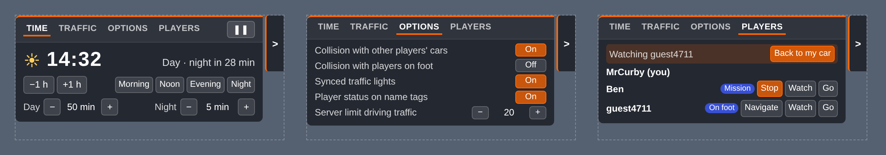
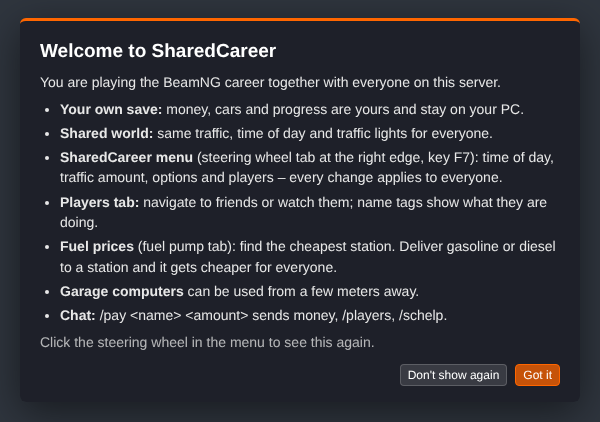
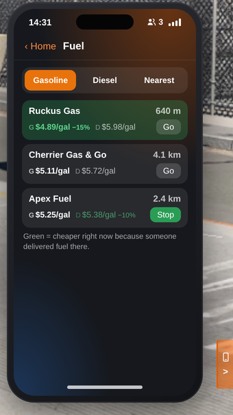
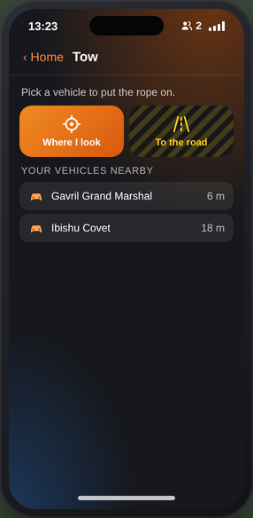
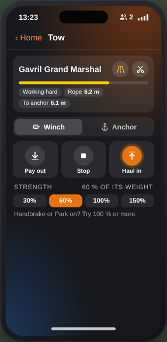

# In-game guide

Everything players see and use in the game. All texts in the game are in English.

- [Joining](#joining)
- [The SharedCareer menu](#the-sharedcareer-menu)
- [Welcome dialog](#welcome-dialog)
- [Finding other players](#finding-other-players)
- [Shared fuel prices](#shared-fuel-prices)
- [Traffic](#traffic)
- [Time of day](#time-of-day)
- [Garage](#garage)
- [Node grabber](#node-grabber)
- [Moving your vehicles by hand (rope and winch)](#moving-your-vehicles-by-hand-rope-and-winch)
- [Phone](#phone)
- [Sending money](#sending-money)

## Joining

When you join, the map loads and your career **starts on its own**. It opens your own save, or creates one in *Open World* mode on your first visit. Other players' cars are protected while your career loads. Without SharedCareer the game would delete them.

Important messages appear as a notification or a dialog in the game, not only in the chat. This includes career loaded, career start failed, version mismatch and money transfers. If the career doesn't load within 60 seconds, the loading screen is released and the server is told what happened, so you never get stuck in a loading screen.

## The SharedCareer menu



One window for everything you can change in the game. **Every change applies to all players at once**, and everybody sees a short notification about who changed what. If several players have the menu open, all of them see the new values immediately.

- The menu is added to your career UI automatically on your first join, at the right edge below the BeamMP player list.
- The **steering-wheel tab** at the right screen edge opens and closes it. **F7** does the same.
- To use another key, open *Options → Controls → BeamMP*, entry "SharedCareer: show/hide menu".
- The window remembers whether it is open and which tab you used last.
- If you removed it, you can add it again: UI app menu → *Add app* → category **BeamMP** → **SharedCareer Menu**.

### Time tab

- The current time, day or night, and how long until the switch
- **❚❚ Pause** stops the clock for everyone at the current time. **▶ Resume** lets it run on from there.
- **−1 h / +1 h**, or jump to **Morning** (7:00), **Noon** (12:00), **Evening** (19:00) or **Night** (23:00)
- Length of the day (in 5-minute steps) and the night (in 1-minute steps)

### Traffic tab

- **Driving and parked cars per player**, changed live
- **AI style**: *Careful*, *Normal* or *Fast*
- How many cars you get right now (the server limit is shared between all players) and how far the amount can be raised live

### Options tab

- **Collision with other players' cars**, on or off. AI traffic and parked cars **always** collide, no matter who spawned them.
- **Collision with players on foot**. Off by default, so nobody runs over a friend by accident.
- **Synced traffic lights**, on or off
- **Player status on name tags**, on or off
- **Server limit driving traffic**

### Players tab

See [Finding other players](#finding-other-players).

### Who may change settings

By default everybody may. A server admin can lock settings with `sc set server.allowPlayerSettings false` (traffic and options) or `sc set server.allowPlayerTimeControl false` (time). The menu then only shows the values. To keep the server calm, each player can send at most one change per half second. Fast clicks are combined into one change.

## Welcome dialog



A few seconds after your career has loaded, a card in the middle of the screen lists the most important features.

- **Got it** closes it. It comes back on your next join.
- **Don't show again** hides it on this PC for good. The choice is stored in `settings/sharedCareer/state.json` in your BeamNG user folder.
- Click the **steering-wheel logo** in the menu to see it again at any time.
- Server admins can switch it off for everyone with `sc set client.showWelcome false`.

Messages from the server, such as the guest notice, a version mismatch or a failed career start, use the same card.

## Finding other players

The **Players** tab lists everyone on the server with what they are doing right now:

| Button | What it does |
|---|---|
| **Navigate** | Shows a route on the road to that player. It follows them when they drive on. **Stop** ends it. |
| **Watch** | Moves your camera to that player. **Back to my car** brings you back. Your traffic stays around your own car while you watch. |
| **Go** | Teleports your current vehicle to that player. This is only available if the server allows it (`sc set server.allowTeleport true`), because in a career it skips driving and fuel costs. |

**Name tags** show what others are doing: `[Mission]`, `[On foot]` or `[Loading]`. You can switch this off in the Options tab.

**Riding along** is built into BeamMP: get into another player's car to become the passenger, and press `C` for the passenger camera.

## Shared fuel prices

A small shared economy that makes delivery jobs matter for everyone:

- **Everybody pays the same price at a station.** Normally the game rolls a random price per player when the map loads. SharedCareer uses the map's base price without the random part.
- **Deliver gasoline or diesel to a station** with a tanker delivery job, and **that fuel gets cheaper at that station for everyone**: by default 5 % per 1,000 liters, up to 30 %.
- **The discount slowly wears off**, by default 1 percentage point every 5 minutes. A station only stays cheap if people keep delivering.
- The **price signs at the road** show the current price.
- Everybody gets a notification, for example *"Ben delivered 2000 l of diesel to Apex – diesel there is now 10% cheaper"*.
- Discounts are saved on the server and survive a restart.
- Your insurance fuel discount still applies on top.

### Fuel app on the phone



Open the phone (**F4**) and tap **Fuel**:

- All stations of the map with gasoline (**G**) and diesel (**D**) prices, in the map's unit. On West Coast USA that is per gallon, like the signs.
- **Sort** by gasoline or diesel price, cheapest first and highlighted in green, or by distance (**Nearest**).
- A green *−10 %* means that fuel is currently cheaper there because of deliveries.
- Distance to you, and **Go** to set a route to the station. **Stop** ends it. The station's position is the middle of its pumps. The route is the game's own navigation on the map's road network.
- The prices are exactly what you pay at the pump, before your insurance discount.

## Traffic

- Traffic spawns as **simplified vehicles** (`simple_traffic`). They look a bit plainer, but cost much less to sync between all players.
- The **AI drives more carefully** than in single player. Two settings do that, and police are not affected by either:
  - lower *aggression* (`client.trafficAggression`): more distance to the car ahead, earlier braking behind it
  - a lower *grip estimate* (`client.trafficGrip`): the AI thinks its tires grip less, so it brakes earlier and more gently at intersections and traffic lights and takes corners more slowly
  - a larger *safety gap* (`client.trafficReactionGap`) and a longer *sight range* (`client.trafficSightRange`): the AI notices a slow or standing vehicle on its path earlier (about 190 m instead of 114 m ahead at 100 km/h) and starts braking sooner. This helps when you maneuver a truck on the road. It does not make traffic drive slower.

  The game has no official setting for the last two. SharedCareer finds the values inside the game's AI code while it runs and changes them there; it never edits game files. If a game update renames them, nothing changes and `beamng.log` says `AI tuning not applied`. When it works, every traffic car logs `AI tuning active` once.
- The server has a **total limit** for driving and parked traffic and splits it across all players, so more players don't mean more lag.
- Other players' cars are never treated as your traffic, so your police won't chase them and your traffic won't take them over.
- Your traffic doesn't show your name tag.

**Changing the amount live:** when you join, you spawn your traffic plus a small hidden **reserve** (default 4 cars). The menu shows or hides cars from that pool, the same way the game does for missions.

- **Lowering** the amount always works immediately.
- **Raising** it works immediately up to the pool size, shown as "live up to …" in the menu. Anything above that applies on your next join.

Spawning new cars in the middle of the game would make BeamMP build them on every PC at once, which causes stutter. That is why the mod uses a reserve instead.

## Time of day

The server runs one clock for everybody. By default a day lasts **50 real minutes** (6:00–20:00) and a night **5 minutes** (20:00–6:00). Every client re-syncs every 30 seconds. Time, weather, slow motion and traffic in the pause menu are display-only, so nobody changes the world for themselves by accident.

## Garage

- **Use garage computers from a distance.** On West Coast USA the computer zones are enlarged to about 14 × 12 m, roughly the whole room, instead of about 2 × 1.4 m right in front of the screen. On other maps the computers get a smaller boost while you play (`client.computerAccessRange`, default 6 m).
- **No duplicate cars** when you change parts, tune or paint at the garage computer.
- Cars that the career hides or shows (garage, dealership) are hidden and shown for everyone else too.
- Players on foot appear as a visible character for others.

## Node grabber

The normal career only lets you use the node grabber (grab and pull vehicles with the mouse) while walking. On a SharedCareer server you can also use it in a vehicle and in the free camera, for example to put a flipped car back on its wheels or to help a friend out of a ditch. The vehicle certification test still blocks it, so test results stay fair.

Server admins can switch back to the career's rule with `sc set client.allowNodeGrabber false`. It applies immediately.

**The pull is weaker than in freeroam.** BeamNG limits the grab force in the career inside the game engine; the single-player career is just as weak. A mod can't change that, so in the career the node grabber is good for nudging and turning cars, but not for throwing them around. For heavier work, use SharedCareer's rope and winch in the Tow app, see below.

## Moving your vehicles by hand (rope and winch)

Because the game's node grabber is so weak in the career, SharedCareer has its own: a rope with a winch. It's made for moving vehicles that can't drive anymore, slowly and by hand, for example onto a tow truck.

Everything runs in the **Tow** app on the phone, as a remote control. There are no extra keys.

### The Tow app

 

Open the phone (**F4**) and tap **Tow**:

- **Attach:** "Attach where I look" puts the rope where the middle of your screen points; a see-through blue ball shows where (only while the Tow app is open). Or tap one of **your vehicles nearby** in the list: the rope goes on the point of that vehicle closest to you.
- **Anchor remote:** hold ▲ ▼ ◀ ▶ to move the anchor away/towards you and left/right (as seen from your view), **Up** / **Down** to raise or lower it. The vehicle doesn't move; the rope just gets longer. ◎ puts the anchor in the middle of your view. **Fine** makes everything four times slower, for exact placing.
- **Winch:** **Pay out** (rope gets longer, e.g. to lower a lifted end), **Stop** (rope holds), **Haul in** (pulls the vehicle slowly to the anchor, by default at most 1 m/s; it stops half a meter before it and doesn't roll past).
- The card at the top shows the vehicle, the rope length, the distance to the anchor and how hard the rope pulls. If the rope has pulled at its limit for a couple of seconds, an orange hint below the strength buttons says so.
- **Tow to the road:** for a vehicle the rope can't free, e.g. one wrapped around a lamp post. Without a rope it takes the vehicle you look at (like "Attach where I look"), with a rope the vehicle on the rope. It puts the vehicle on the last road it drove on, like "Tow to road" in the game's recovery menu, but free of charge; the damage stays. The vehicle must stand still, and it doesn't work during a police chase.
- **Remove rope** at the bottom.

It behaves like a real rope: it only pulls when it's taut, never pushes. The force is limited to the pull strength picked in the Tow app (60 % of the vehicle's weight at first, see below). Below 100 % you can lift one end (put the anchor up high) and drag the vehicle, but not float it. Pull a corner and the vehicle turns; the wheels roll. The force goes mostly to the heavy frame parts around the rope's end, so nothing gets bent.

What you see:

- **Rope:** a thin rope from the vehicle to the anchor, grey when slack, and it sags – the more rope is out, the deeper; it straightens as it is pulled taut. When taut, the color shows how hard the winch works: **green** is easy, **yellow** is working hard, **red** means it's at its force limit (too heavy, stuck, or trying to lift too much). The colors fade smoothly into each other, and the rope stays on the vehicle while it moves.
- **Anchor:** a pin (a post with a ball on top); white when resting, cyan while you move it, orange while the winch hauls in (the ball pulses), purple while it pays out. When it hangs in the air, a dashed line down to a disc on the ground shows where it is. While the Tow app is open, a sign above it shows the distance to the vehicle, and "at the limit" when the rope has been pulling as hard as it can for a while.
- **Winch running:** while the rope runs through the winch, light marks on it travel with it: towards the anchor when it hauls in, towards the vehicle when it pays out. They move as fast as the rope really does, so when they stand still while hauling in, the vehicle is stuck.
- **Grip:** a small ball where the rope is tied – the point you aimed at, where the blue preview ball was.
- **Rope off:** when the rope comes off, it doesn't just vanish. A taut rope snaps back to the anchor, a slack one drops; both fade out within a moment.

The rope comes off by itself, with a short message, when the vehicle is reset or moved by the game (e.g. recovery), when the part it is tied to tears off, or when the vehicle stops answering (e.g. after reloading it). Otherwise it would pull the vehicle back to the old anchor, or drag the loose part around.

It only works on your own vehicles and your own traffic: other players' vehicles are simulated on their PCs, and BeamMP would put them right back. Players on foot can't be roped, and neither can the vehicle you are sitting in (the camera would move with it). Get out, or use the free camera.

Server admins can switch it off with `sc set client.allowGrab false`, and set how fast the winch hauls in (`client.grabSpeed`, m/s) and the highest pull strength a player may pick (`client.grabStrength`, % of the vehicle's weight). "Tow to the road" can be switched off on its own with `sc set client.allowTowToRoad false`.

**Pull strength:** in the Tow app you pick 30, 60, 100 or 150 % of the vehicle's weight (60 % at first). If the vehicle doesn't follow – stuck, handbrake on, gear in Park – the pull builds up to that limit within about two seconds. If it still doesn't move, pick more; a handbrake or Park usually needs 100 % or more.

## Phone


Press **F4** or click the phone tab at the right screen edge (directly below the SharedCareer menu's tab) to take out your phone. It shows the server's time, whether it's day or night, how many players are on the server and whether you're connected.

Apps:

- **Tow:** rope and winch as a remote control, see [Moving your vehicles by hand](#moving-your-vehicles-by-hand-rope-and-winch).
- **Fuel:** gas station prices, see [Fuel app on the phone](#fuel-app-on-the-phone).

- The bar at the bottom goes back to the home screen from an app, or puts the phone away.
- Opening the phone collapses the SharedCareer menu, and the other way round.
- The key is rebindable under *Options → Controls → BeamMP*, entry "SharedCareer: phone".
- Server admins can switch it off with `sc set client.phone false`.

## Sending money

```
/pay <name> <amount>
```

Part of the name is enough, and names may contain spaces. The money is taken from your save first and then added to the receiver's save. If the receiver leaves or doesn't confirm within 30 seconds, you get the money back. Limits are set by the server (`server.paymentMax`, `server.paymentCooldownSeconds`).

Other chat commands: `/players` (who is here, who is still loading) and `/schelp` (help).
