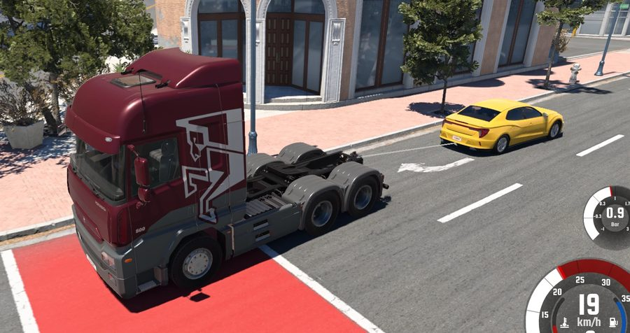
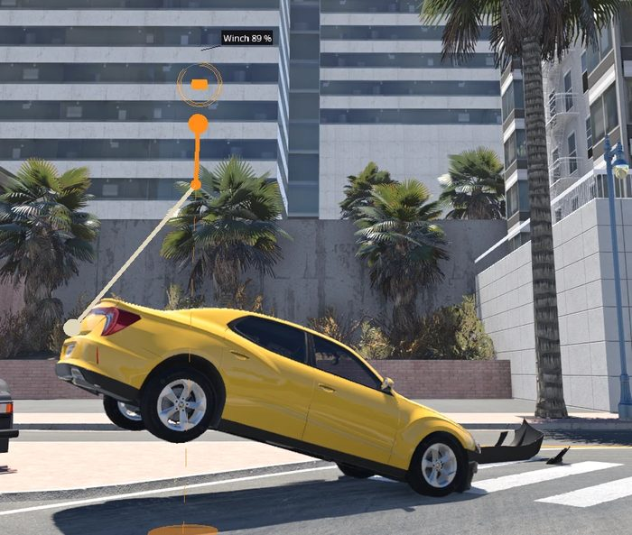
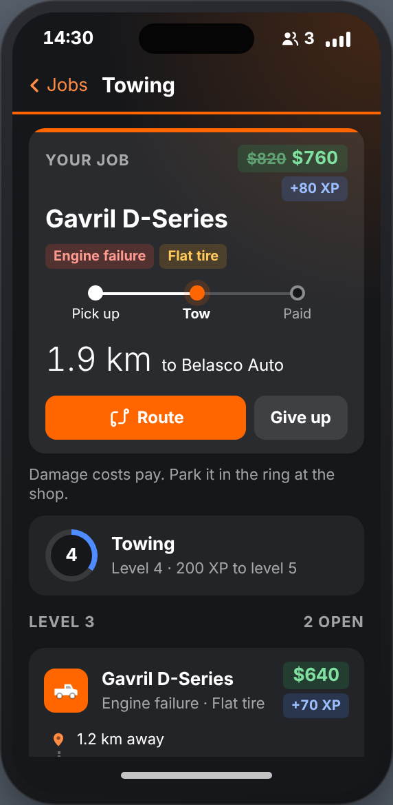
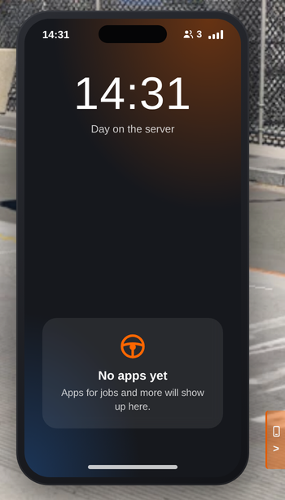

# In-game guide

Everything players see and use in the game. All texts in the game are in English.

- [Joining](#joining)
- [The SharedCareer menu](#the-sharedcareer-menu)
- [Welcome dialog](#welcome-dialog)
- [Finding other players](#finding-other-players)
- [Shared fuel prices](#shared-fuel-prices)
- [Traffic](#traffic)
- [Everyone sees the same cars](#everyone-sees-the-same-cars)
- [Time of day](#time-of-day)
- [Garage](#garage)
- [Node grabber](#node-grabber)
- [Moving your vehicles by hand (rope and winch)](#moving-your-vehicles-by-hand-rope-and-winch)
- [Strapping a car down (straps)](#strapping-a-car-down-straps)
- [Towing jobs (beta)](#towing-jobs-beta)
- [Phone](#phone)
- [Sending money](#sending-money)

## Joining

When you join, the map loads and your career **starts on its own**. It opens your own save, or creates one in *Open World* mode on your first visit. Other players' cars are protected while your career loads. Without SharedCareer the game would delete them.

Important messages appear as a notification or a dialog in the game, not only in the chat. This includes career loaded, career start failed, version mismatch and money transfers. If the career doesn't load within 60 seconds, the loading screen is released and the server is told what happened, so you never get stuck in a loading screen.

## The SharedCareer menu


One window for everything you can change in the game. **Every change applies to all players at once**, and everybody sees a short notification about who changed what. If several players have the menu open, all of them see the new values immediately.

- The menu is added to your career UI automatically on your first join, at the right edge below the BeamMP player list.
- The **steering-wheel tab** at the right screen edge opens and closes it. **F7** does the same.
- To use another key, open *Options → Controls → BeamMP*, entry "SharedCareer: show/hide menu".
- The window remembers whether it is open and which tab you used last.
- If you removed it, you can add it again: UI app menu → *Add app* → category **BeamMP** → **SharedCareer Menu**.

### Time tab

- The current time, day or night, and how long until the switch
- **❚❚ Pause** stops the clock for everyone at the current time. **▶ Resume** lets it run on from there.
- **−1 h / +1 h**, or jump to **Morning** (7:00), **Noon** (12:00), **Evening** (19:00) or **Night** (23:00)
- Length of the day (in 5-minute steps) and the night (in 1-minute steps)

### Traffic tab

- **Driving and parked cars per player**, changed live
- **AI style**: *Careful*, *Normal* or *Fast*
- How many cars you get right now (the server limit is shared between all players) and how far the amount can be raised live

### Options tab

- **Collision with other players' cars**, on or off. AI traffic and parked cars **always** collide, no matter who spawned them.
- **Collision with players on foot**. Off by default, so nobody runs over a friend by accident.
- **Synced traffic lights**, on or off
- **Player status on name tags**, on or off
- **Server limit driving traffic**

### Players tab

See [Finding other players](#finding-other-players).

### Who may change settings

By default everybody may. A server admin can lock settings with `sc set server.allowPlayerSettings false` (traffic and options) or `sc set server.allowPlayerTimeControl false` (time). The menu then only shows the values. To keep the server calm, each player can send at most one change per half second. Fast clicks are combined into one change.

## Welcome dialog


A few seconds after your career has loaded, a card in the middle of the screen lists the most important features.

- **Got it** closes it. It comes back on your next join.
- **Don't show again** hides it on this PC for good. The choice is stored in `settings/sharedCareer/state.json` in your BeamNG user folder.
- Click the **steering-wheel logo** in the menu to see it again at any time.
- Server admins can switch it off for everyone with `sc set client.showWelcome false`.

Messages from the server, such as the guest notice, a version mismatch or a failed career start, use the same card.

## Finding other players

The **Players** tab lists everyone on the server with what they are doing right now:

| Button | What it does |
|---|---|
| **Navigate** | Shows a route on the road to that player. It follows them when they drive on. **Stop** ends it, and so does a new route (a towing job, a gas station). |
| **Watch** | Moves your camera to that player. **Back to my car** brings you back. Your traffic stays around your own car while you watch. |
| **Go** | Teleports your current vehicle to that player. This is only available if the server allows it (`sc set server.allowTeleport true`), because in a career it skips driving and fuel costs. |

**Name tags** show what others are doing: `[Mission]`, `[On foot]` or `[Loading]`. You can switch this off in the Options tab.

**Riding along** is built into BeamMP: get into another player's car to become the passenger, and press `C` for the passenger camera.

## Shared fuel prices

A small shared economy that makes delivery jobs matter for everyone:

- **Everybody pays the same price at a station.** Normally the game rolls a random price per player when the map loads. SharedCareer uses the map's base price without the random part.
- **Deliver gasoline or diesel to a station** with a tanker delivery job, and **that fuel gets cheaper at that station for everyone**: by default 5 % per 1,000 liters, up to 30 %.
- **The discount slowly wears off**, by default 1 percentage point every 5 minutes. A station only stays cheap if people keep delivering.
- The **price signs at the road** show the current price.
- Everybody gets a notification, for example *"Ben delivered 2000 l of diesel to Apex – diesel there is now 10% cheaper"*.
- Discounts are saved on the server and survive a restart.
- Your insurance fuel discount still applies on top.

### Fuel app on the phone


Open the phone (**F4**) and tap **Fuel**:

- All stations of the map with gasoline (**G**) and diesel (**D**) prices, in the map's unit. On West Coast USA that is per gallon, like the signs.
- **Sort** by gasoline or diesel price, cheapest first and highlighted in green, or by distance (**Nearest**).
- A green *−10 %* means that fuel is currently cheaper there because of deliveries.
- Distance to you, and **Go** to set a route to the station. **Stop** ends it. The station's position is the middle of its pumps. The route is the game's own navigation on the map's road network.
- The prices are exactly what you pay at the pump, before your insurance discount.

## Traffic

- Traffic spawns as **simplified vehicles** (`simple_traffic`). They look a bit plainer, but cost much less to sync between all players.
- The **AI drives more carefully** than in single player. These settings do that, and police are not affected by any of them:
  - lower *aggression* (`client.trafficAggression`): more distance to the car ahead, earlier braking behind it
  - a lower *grip estimate* (`client.trafficGrip`): the AI thinks its tires grip less, so it brakes earlier and more gently at intersections and traffic lights and takes corners more slowly
  - a larger *safety gap* (`client.trafficReactionGap`) and a longer *sight range* (`client.trafficSightRange`): the AI notices a slow or standing vehicle on its path earlier and starts braking sooner, which helps when you maneuver a truck on the road. Traffic doesn't drive any slower.
- The server has a **total limit** for driving and parked traffic and splits it across all players, so more players don't mean more lag.
- Other players' cars are never treated as your traffic, so your police won't chase them and your traffic won't take them over.
- Your traffic doesn't show your name tag.

**Changing the amount live:** when you join, you spawn your traffic plus a small hidden **reserve** (default 4 cars). The menu shows or hides cars from that pool, the same way the game does for missions.

- **Lowering** the amount always works immediately.
- **Raising** it works immediately up to the pool size, shown as "live up to …" in the menu. Anything above that applies on your next join.

Spawning new cars in the middle of the game would make BeamMP build them on every PC at once, which causes stutter. That is why the mod uses a reserve instead.

## Everyone sees the same cars

In BeamMP every car belongs to one player: only that player's PC really drives it, and everyone else sees a copy. SharedCareer keeps those copies true to the original:

- **Hidden and shown cars:** the game keeps swapping traffic cars in and out, and the career hides cars in the garage. Every player reports what is hidden every second, so nobody bumps into a car only they can see.
- **Spawning:** your traffic and parked cars keep about 40 m away from other players, so they don't appear on top of them or vanish right next to them.
- **Damage:** a crashed car takes its driver's shape on your screen once it stands still for a moment, including dents, broken glass and lights. If you saw a crash the driver didn't (a car only you could see), the car is straightened again. Traffic keeps the damage your own PC works out. Server owners can turn this off (`client.syncDamage`).
- **Trailers and dollies** stay coupled for everyone, also for players who join later.
- **Pausing:** opening a menu, the big map or a garage computer pauses your game. Other players' cars no longer blow up because of that.

## Time of day

The server runs one clock for everybody. By default a day lasts **50 real minutes** (6:00–20:00) and a night **5 minutes** (20:00–6:00). Every client re-syncs every 30 seconds. Time, weather, slow motion and traffic in the pause menu are display-only, so nobody changes the world for themselves by accident.

## Garage

- **Use garage computers from a distance.** On West Coast USA the computer zones are enlarged to about 14 × 12 m, roughly the whole room, instead of about 2 × 1.4 m right in front of the screen. On other maps the computers get a smaller boost while you play (`client.computerAccessRange`, default 6 m).
- **No duplicate cars** when you change parts, tune or paint at the garage computer.
- Cars that the career hides or shows (garage, dealership) are hidden and shown for everyone else too.
- Players on foot appear as a visible character for others.

## Node grabber

The normal career only lets you use the node grabber (grab and pull vehicles with the mouse) while walking. On a SharedCareer server you can also use it in a vehicle and in the free camera, for example to put a flipped car back on its wheels or to help a friend out of a ditch. The vehicle certification test still blocks it, so test results stay fair.

Server admins can switch back to the career's rule with `sc set client.allowNodeGrabber false`. It applies immediately.

**The pull is weaker than in freeroam.** BeamNG limits the grab force in the career inside the game engine; the single-player career is just as weak. A mod can't change that, so in the career the node grabber is good for nudging and turning cars, but not for throwing them around. For heavier work, use SharedCareer's rope and winch in the Tow app, see below.

## Moving your vehicles by hand (rope and winch)

The game's node grabber is too weak in the career to move a heavy car, so SharedCareer has a rope with a winch. It's made for vehicles that can't drive anymore: drag one out of a ditch, pull it onto a tow truck, or tow it behind another car. Everything runs in the **Tow** app on the phone, like a remote control.

### Using the Tow app

 

1. **Attach the rope:** open the phone (**F4**) → **Tow**, then tap **Attach rope** – it goes where you look, a blue ball shows the spot – or one of **your vehicles** below it.
2. **Place the anchor:** hold the arrows to move it, **Up** / **Down** to raise or lower it, **Fine** for slow, exact moves. The vehicle stays put while the rope just gets longer.
3. **Pull:** **Haul in** winds the rope and pulls the vehicle to the anchor. **Pay out** gives rope, for example to lower a lifted end. **Stop** locks the rope at its length, like a tow rope.

With a rope on, everything is on one screen: at the top the rope itself – your vehicle, the rope with its length and state, the anchor – then the **Winch** panel and the **Anchor** panel with the remote. The rope there sags while it is slack, turns orange and red under a high load, and marks run along it while the winch turns.

**Towing with another vehicle:** the anchor can go onto any of your vehicles, at any point. Move it close to one: a **ring** shows where it would hook on, with a dashed line from the anchor. It is **green** on a tow hitch and **white** elsewhere. Tow hitches within a few meters show as faint green rings, so you can find them. Then tap **Hook on**; nothing hooks on by itself. The anchor now moves with that vehicle: drive off to tow, or stand still and haul in like a tow truck. **Unhook** leaves the anchor where it is, and you can move it again. Drive off gently, because a hard jolt can snap the rope.

**Loading it onto a tow truck:** hook the anchor onto the truck, haul the car up onto it and tap **Stop**. Once the rope is short (3 m or less), a yellow **Strap down** button appears below the anchor. It straps the car down onto that truck, the same as in the Straps app, without aiming. Afterwards the Straps app offers **Remove rope**, so you can take the rope off there.

The ring picks a tow hitch within 0.7 m first, otherwise the nearest sturdy point within 0.5 m. Light parts like mirrors, glass or thin panels are passed over if a sturdy point is in reach, because the rope would only tear them off.

**Pull strength:** pick 30, 60, 100 or 150 % of the vehicle's weight in the app (60 % at first). If the vehicle doesn't follow, it's stuck or the parking brake is on: pick more.

**To the road:** for a vehicle the rope can't free, for example one wrapped around a lamp post. It puts the vehicle back on the last road it drove on, free of charge, damage included. The vehicle must stand still, and it doesn't work during a police chase.

  

### What you see

- **The rope** sags when it's slack and turns **yellow, orange** and finally **red** as it gets close to snapping. Then slow down.
- **The ring above the anchor** shows how hard the winch works, from green to **blinking red** when it's at its limit: too heavy, stuck, or trying to lift too much.
- **Light marks on the rope** move as fast as it is wound in. If they stand still while you haul in, the vehicle is stuck.

### Good to know

- The rope behaves like a real one: it is stiff, only pulls and never pushes, and snaps only on a hard jolt. The winch alone never breaks it.
- The rope comes off by itself when the vehicle is reset or recovered, when the part it's tied to tears off, or when it snaps.
- It works on your own vehicles and your own traffic only. Other players' cars are driven by their PCs. You can't rope the vehicle you are sitting in, but you can hook the anchor onto it to tow.
- Server admins can switch it off (`client.allowRopes`, together with the Straps app), set the winch speed (`client.winchSpeed`) and the highest pull strength (`client.winchStrength`). "To the road" can be switched off on its own (`client.allowTowToRoad`).

## Strapping a car down (straps)

A car on a flatbed or a trailer slides off in the first curve. The **Straps** app on the phone holds it down with ratchet straps, like real tie-down straps: each one runs from the car to the truck or trailer below it and is pulled tight when it goes on.

- **Strap down:** look at the car and tap it. Four straps go on at once, one at each corner of the car, down to the nearest sturdy point of your vehicle below. If a corner has nothing in reach, it is left out ("3 of 4 strapped").
- **Add strap:** one strap by hand. *1.* Look at the car (a blue ball shows where the strap goes) and tap **Here**. *2.* Look at the truck or trailer (a ring shows where it hooks on) and tap **Here**. A dashed line runs from the car to the ring; it turns red if the strap would be longer than 3 m. **Cancel** takes it off again.
- **The list** shows every strap with a dot for its load: green is fine, yellow is high, red is close to snapping, grey is slack. Remove one with its button, or all with **Remove all**.
- **Remove rope:** if the tow rope from the Tow app is still on a strapped car, this button takes it off.
- **Coming from the Tow app:** a car you hauled onto a truck can be strapped down right there, see [Loading it onto a tow truck](#using-the-tow-app).

In the world, straps are a **wide yellow band** with a **ratchet** (a dark block with a yellow lever) at the lower end. Like the rope, they turn orange and red under a high load.

Good to know:

- Drive gently with a load. A strap only snaps on a hard jolt, but a crash can tear it.
- A strap comes off when the car or the truck is reset or removed, when the part it holds tears off, or when it snaps.
- Your own vehicles only, like the rope. You can have the rope and straps at the same time, for example to winch a car onto a flatbed and then strap it down.
- Server admins switch straps on and off together with the rope (`client.allowRopes`).

## Towing jobs (beta)



> **Experimental.** Towing jobs are new; pay, places and rules may still change. The Jobs app is marked **BETA** on the phone.

Cars break down at the roadside, and somebody has to tow them to a repair shop. There is **one list for everyone** on the server: whoever takes a job first gets it.

1. **Find a job:** phone (**F4**) → **Jobs**. Every job shows the vehicle, what's wrong (engine failure, sometimes a flat tire too), how far it is from you, the repair shop, the length of the tow and the pay.
2. **Take it:** the route leads you to the breakdown. A marker floats above the car when you are close. It's yours now: the others see the job as taken.
3. **Pick it up:** the car stands beside the road with the hazard lights on. Its engine won't start (resetting it doesn't help), it's in neutral with the parking brake off, so you can tow it: on a flatbed, on a trailer, or with the rope and winch from the Tow app. Close to it, the route switches to the repair shop.
4. **Deliver it:** at the shop a ring on the ground shows the drop-off zone. Leave the car standing in it for 3 seconds, with nobody inside. The pay goes to your account and the car is taken away. If you crash or lose the connection right then, the pay arrives on your next join.

- **Pay:** $150 plus $120 per km of the tow, 25 % more with a flat tire. The server can change it (`client.jobPay`).
- **Damage costs:** new damage on the way costs part of the pay, up to half of it. Dragging the car along on the rope is allowed, but it usually costs more than loading it.
- **Your job on the phone:** the Jobs app shows your job with its steps (*Pick up → Tow → Paid*), the distance and **Route** to set the route again. The Tow and Straps apps show it in a small strip at the top.
- **Give up** in the Jobs app removes the car; the job is open again for everyone. If you leave the server or don't finish within 30 minutes, it is open again too.
- New jobs come in by themselves, at most 3 open at a time. They appear only on normal roads and never right next to a player.

## Phone



Press **F4** or click the phone tab at the right screen edge (directly below the SharedCareer menu's tab) to take out your phone. It shows the server's time, how many players are on the server and whether you're connected. Below the clock it says how long until night (or day), with a bar for how much of the day or night is over.

The phone goes away when you open a game menu (pause menu, map, garage, ...); there, **F4** only puts it away.

Apps:

- **Jobs** *(beta)*: towing jobs, see [Towing jobs](#towing-jobs-beta). Apps that are still experimental carry a **BETA** badge.
- **Tow:** rope and winch as a remote control, see [Moving your vehicles by hand](#moving-your-vehicles-by-hand-rope-and-winch).
- **Straps:** strap a car down on a truck or trailer, see [Strapping a car down](#strapping-a-car-down-straps).
- **Fuel:** gas station prices, see [Fuel app on the phone](#fuel-app-on-the-phone).

- The bar at the bottom goes back to the home screen from an app, or puts the phone away.
- Opening the phone collapses the SharedCareer menu, and the other way round.
- The key is rebindable under *Options → Controls → BeamMP*, entry "SharedCareer: phone".
- Server admins can switch it off with `sc set client.phone false`.

## Sending money

```
/pay <name> <amount>
```

Part of the name is enough, and names may contain spaces. The money is taken from your save first and then added to the receiver's save. If the receiver leaves or doesn't confirm within 30 seconds, you get the money back. Limits are set by the server (`server.paymentMax`, `server.paymentCooldownSeconds`).

Other chat commands: `/players` (who is here, who is still loading) and `/schelp` (help).
